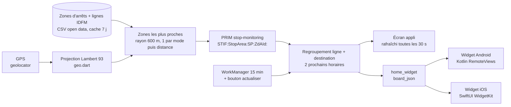

# Metro Widget IDF

Créé par : Omar Pérez - 2026-11-09 08:10

Application Flutter (Android + iOS) et widget d'écran d'accueil. Elle trouve les arrêts les plus proches de votre position et affiche les **2 prochains passages** de chaque ligne et direction (métro, RER, Transilien, tram, bus), avec un affichage de type écran de quai RATP (fond bleu nuit, minutes en ambre).

## Fonctionnement



| Fichier | Rôle |
|---|---|
| `lib/config.dart` | Paramètres communs : URLs, rayon, nombre de lignes, App Group |
| `lib/geo.dart` | WGS84 vers Lambert 93 (EPSG:2154), vérifié contre pyproj |
| `lib/referentials.dart` | Téléchargement et cache des référentiels `zones-d-arrets` et `referentiel-des-lignes` |
| `lib/prim_client.dart` | Appel de l'API PRIM « Prochains passages » et lecture de la réponse SIRI Lite |
| `lib/board_service.dart` | Position, arrêts proches, passages, construction du tableau et envoi au widget |
| `lib/background.dart` | Tâche périodique WorkManager et bouton d'actualisation du widget |
| `lib/main.dart` | Écran de l'appli |
| `android/.../NextPassWidgetProvider.kt` | Rendu du widget Android ; recalcule les minutes chaque minute sans appel réseau |
| `ios/NextPassWidget/NextPassWidget.swift` | Widget iOS, avec une timeline de 15 entrées (une par minute) |

Distance : $d = \sqrt{(x_z - x_u)^2 + (y_z - y_u)^2}$ en Lambert 93. L'erreur d'échelle reste sous 0,1 % en Île-de-France.

## 0. Installation directe depuis le téléphone (sans PC)

GitHub Actions compile l'APK à chaque `push` sur `main` (`.github/workflows/build-apk.yml`) et le publie dans **Releases**.
1. Sur le téléphone, ouvrir le dépôt GitHub > *Releases* > dernière version > `metro_widget.apk`.
2. Ouvrir le fichier téléchargé > autoriser « installer des applis inconnues » pour le navigateur > *Installer*.
3. Au premier lancement : accepter la localisation, saisir la clé PRIM (icône clé).

La clé de signature `android/keystore/debug.keystore` est fixe : les nouvelles versions s'installent par-dessus sans désinstaller. Option : secret GitHub `PRIM_API_KEY` pour intégrer la clé dans l'APK (déconseillé si le dépôt est public).

## 1. Clé API PRIM (gratuite)

1. Créez un compte sur https://prim.iledefrance-mobilites.fr.
2. Allez dans *Mon espace* > *Mes jetons* et générez une clé.
3. L'API utilisée est « Prochains passages (plateforme IDFM) - requête unitaire ». Elle est limitée à 1 000 000 de requêtes par jour, ce qui laisse une large marge.

Vous pouvez donner la clé de deux façons : avec `--dart-define=PRIM_API_KEY=...` à la compilation, ou en la saisissant dans l'appli (icône clé). La clé saisie dans l'appli est aussi lue par le widget.

## 2. Android (Windows)

Prérequis : Flutter SDK, Android Studio et un téléphone en mode développeur branché en USB.

```powershell
cd C:\Users\Omar\Desktop\Code\metro_widget_idf     # ou C:\Users\a14383\Desktop\...
.\setup.ps1 -ApiKey "VOTRE_CLE"            # installe et lance sur le téléphone
.\setup.ps1 -ApiKey "VOTRE_CLE" -Build     # génère output\metro_widget.apk
```

`flutter create .` génère uniquement les fichiers manquants (Gradle, MainActivity, icônes). Les fichiers du projet ne sont pas écrasés. Les journaux sont enregistrés dans `output/`.

Pour ajouter le widget : appui long sur l'écran d'accueil > Widgets > « Prochains passages ».
- Toucher le widget ouvre l'appli et lance une mise à jour en direct.
- L'icône ⟳ actualise sans ouvrir l'appli. Elle utilise la dernière position connue.
- Toutes les 15 minutes, WorkManager met les données à jour (c'est le minimum autorisé par Android). Entre deux mises à jour, les minutes sont décomptées localement.

## 3. iOS (Mac obligatoire)

```bash
./setup_ios.sh VOTRE_CLE
```

Ensuite, dans Xcode :
1. *File > New > Target > Widget Extension*, nom `NextPassWidget`, sans « Configuration Intent ». Remplacez le fichier Swift généré par `ios/NextPassWidget/NextPassWidget.swift`.
2. *Signing & Capabilities* : ajoutez **App Groups** `group.com.omarperez.metrowidget` sur **Runner** et sur **NextPassWidget**.
3. Réglez la cible de déploiement de l'extension sur iOS 17 ou plus (le code utilise `containerBackground`).
4. Dans `ios/Runner/AppDelegate.swift`, avant `return super.application(...)`, ajoutez :
   ```swift
   import workmanager_apple
   WorkmanagerPlugin.registerPeriodicTask(withIdentifier: "metro-widget-refresh", frequency: NSNumber(value: 15 * 60))
   ```
   Le nom du module dépend de la version du plugin. Si `workmanager_apple` est introuvable, essayez `import workmanager`.

## Réglages (`lib/config.dart`)

`searchRadiusM` (600 m), `maxZones` (4), `maxRows` (6), `autoRefresh` (30 s), `refCacheDays` (7).

## Sources

- PRIM, *Prochains passages - structure des requêtes* : identifiants `STIF:StopArea:SP:[ZdAId]:` et `STIF:StopPoint:Q:[ArRId]:`. https://prim.iledefrance-mobilites.fr/en/aide-et-contact/documentation/prise-en-main-des-api/prise-en-main-des-api-prochains-passages/structure-des-requetes-parametres-dappel
- PRIM, *Identification des objets* : depuis le 13/03/2025, les données SNCF sont publiées uniquement par zone d'arrêt (ZdA). https://prim.iledefrance-mobilites.fr/en/aide-et-contact/documentation/prise-en-main-des-api/prise-en-main-des-api-prochains-passages/identification-des-objets
- IDFM, *Données issues des référentiels de transport* (2023) : champs `ZdAId`, `ZdAName`, `ZdAXEpsg2154`, `ZdAYEpsg2154`, `ZdAType`, ainsi que `ID_Line`, `ShortName_Line` et `ColourWeb_hexa`. https://eu.ftp.opendatasoft.com/stif/Documentation/2023_idfm_referentiels.pdf
- home_widget 0.9.1 : https://pub.dev/documentation/home_widget
